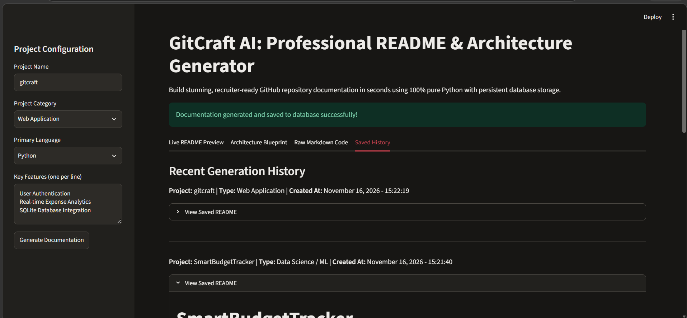

# GitCraft AI - README & Architecture Studio

A Python-based web application built with Streamlit that generates structured GitHub repository documentation, system architecture blueprints, and persistent generation history backed by SQLite3.

---

## Key Features

- *Automated README Generation:* Produces clean, formatted Markdown documentation tailored to project categories and tech stacks.
- *System Architecture Blueprints:* Generates visual ASCII text-based architecture flows automatically.
- *Persistent History Storage:* Integrates a local SQLite3 database (gitcraft_history.db) to store and retrieve previously generated documentation sessions.
- *Instant Raw Markdown Export:* Provides a dedicated view to copy raw Markdown directly for GitHub repositories.

---

## Application Preview



---

## Tech Stack

- *Language:* Python 3.x
- *Web Framework:* Streamlit
- *Database:* SQLite3 (Standard Library)

---

## Installation & Setup

1. Clone the repository:
   ```bash
   git clone https://github.com/prernacy/gitcraft.ai.git
cd gitcraft.ai